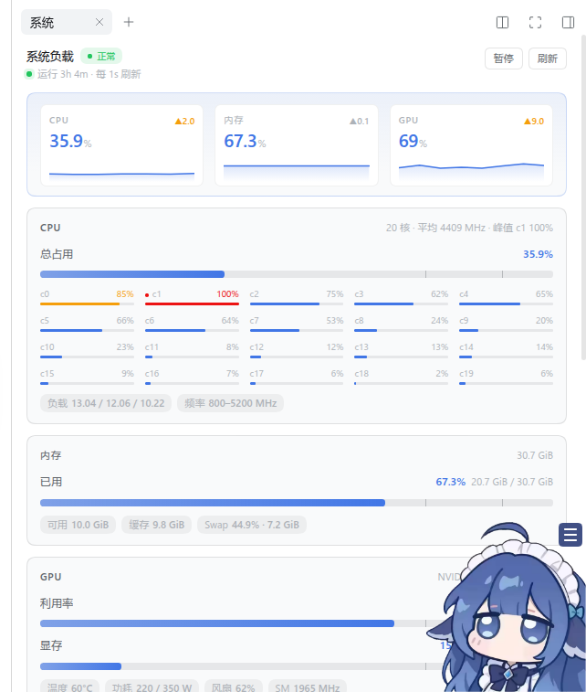
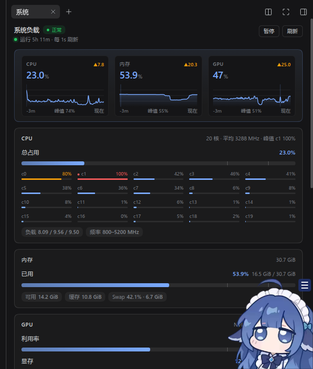
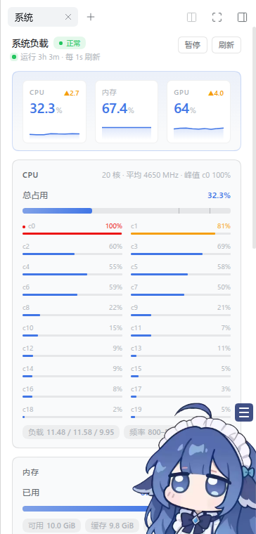

# dsh-system-monitor

DeepSeek Harness（`dsh`）Web GUI 的系统监控插件：右侧栏新增「系统」面板，实时显示 CPU（总占用、
每核、频率）、内存与 Swap、GPU（利用率、显存、温度、功耗、风扇、显存进程）、温度/风扇/功耗，
以及 CPU / 内存占用最高的进程。纯本地采样，只暴露一条回环路由，不联网。

System monitor plugin for the DeepSeek Harness web GUI: a right-sidebar **System** panel with CPU
(per-core + frequency), memory/swap, GPU (via `nvidia-smi`), temperature/fan/power sensors and top
processes. Sampling is local-only (`/proc`, `/sys/class/hwmon`), served through one loopback route.



<details>
<summary>深色主题 / 窄面板（约 360px）</summary>

| 深色 | 窄面板 |
|---|---|
|  |  |

</details>

## 功能

- **生命体征**：CPU / 内存 / GPU 三格 stat tile（大数字 + 近 30 秒变化 + 背景折线），标题旁按最差指标显示 `正常 / 偏高 / 告警`
- **CPU**：总占用、每核网格（含峰值核标记）、负载均值、频率范围
- **内存**：已用 / 可用 / 缓存 / Swap
- **GPU**：利用率、显存、温度、功耗、风扇、SM 频率、显存占用进程（需要 `nvidia-smi`）
- **温度**：`hwmon` 传感器列表（按 100°C 标尺）、风扇转速、封装功耗
- **进程**：CPU / 内存 Top 5，每行带占用比例细条
- 亮色 / 深色主题自适应；面板宽度 320–700px 自适应
- 左侧栏底部常驻摘要小挂件，点击直达面板

## 要求

| 项 | 说明 |
|---|---|
| DeepSeek Harness | `0.2.x` Web profile（在 `0.2.1-rc.2` 上验证） |
| 系统 | Linux（读取 `/proc`、`/sys/class/hwmon`；GPU 需要 `nvidia-smi`） |
| Node.js | `>= 22.3`（宿主自带） |
| 可选 | NVIDIA 驱动 + `nvidia-smi`（无 GPU 时面板显示「无 GPU 遥测」，其余功能正常） |

## 安装

```bash
dsh plugin --profile web add github:MUHAN11-c/dsh-system-monitor
```

然后重启 `dsh web`（或刷新页面，视宿主 HMR 状态），右侧栏会出现「系统」，左侧栏底部出现
`系统 CPU … MEM … GPU …` 小挂件。

本地源码安装：

```bash
git clone https://github.com/MUHAN11-c/dsh-system-monitor.git
dsh plugin --profile web add ./dsh-system-monitor
```

## 更新 / 卸载

```bash
# 重新拉取 main 并安装
dsh plugin --profile web add github:MUHAN11-c/dsh-system-monitor

# 卸载（依赖和 profile bundles 会被一并移除）
dsh plugin --profile web remove dsh-system-monitor
```

## 配置

在 profile 的 `cordis.patch.yml` 里覆盖 `system-monitor` 这一行：

```yaml
- id: system-monitor
  config:
    topProcesses: 8      # 每个 Top 列表的进程数，0 关闭列表，默认 5
    minSampleMs: 500     # 两次内核采样最小间隔（ms），默认 200
    history: 300         # 服务端历史环长度，默认 180（约 3 分钟 @1s）
    gpuTimeoutMs: 1500   # nvidia-smi 超时（ms），默认 1500
    showProcesses: true  # 是否采集进程列表，默认 true
```

| 键 | 默认 | 范围 | 说明 |
|---|---|---|---|
| `topProcesses` | `5` | 0–20 | 每个 Top 列表的条数 |
| `minSampleMs` | `200` | 50–5000 | 内核采样最小间隔 |
| `history` | `180` | 8–1200 | 历史样本数（驱动折线） |
| `gpuTimeoutMs` | `1500` | 200–10000 | `nvidia-smi` 查询超时 |
| `showProcesses` | `true` | — | 关闭后不采集进程列表 |

## 工作原理

| 半边 | 文件 | 作用 |
|---|---|---|
| host | `lib/index.js` | 采样 `/proc/stat`、`/proc/meminfo`、`/proc/loadavg`、`/proc/cpuinfo`、`/proc/<pid>`、`/sys/class/hwmon/**`，有 NVIDIA GPU 时调用 `nvidia-smi`；注册**仅回环**路由 `GET /api/dsh-system-monitor/snapshot`，并维护历史样本环。零外部 import（只用 `process.getBuiltinModule`），任意 profile 布局都能解析。 |
| client | `lib/client.js` | 预构建 bundle（`window.__ModuleLoader__.load`）：注册右侧栏页类型、面板正文/标题席位和侧栏小挂件，每秒轮询上面的快照路由。**无构建步骤**，`require` 只取 shell 模块表里的 `react`。 |

## 隐私

- 不发起任何外部网络请求；`nvidia-smi` 为本地调用。
- 唯一的路由监听在 `127.0.0.1`，跟随 dsh 的 Web 服务，不经公网。
- 进程信息只在本地渲染，不写入日志。

## 开发

仓库没有构建步骤：`lib/client.js` 本身就是可被 `window.__ModuleLoader__` 加载的 bundle，改完直接跑：

```bash
node --check lib/index.js && node --check lib/client.js
npm test          # 用 stub ModuleLoader + stub react 跑一遍注册与导出
```

GitHub Actions 在 push / PR 时执行同样的检查（`.github/workflows/check.yml`）。

## License

[MIT](LICENSE)
